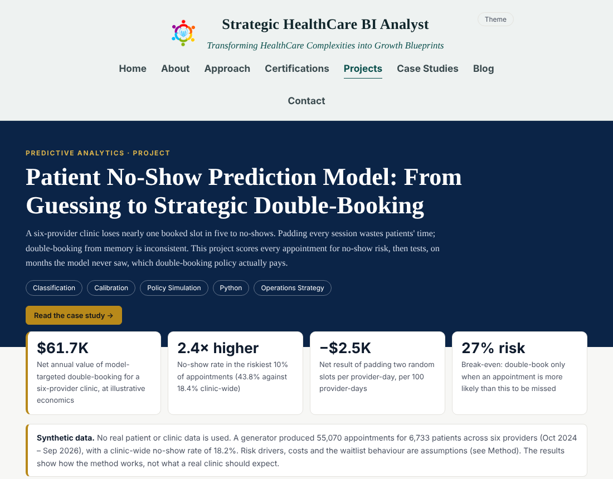

# Patient No-Show Prediction Model: From Guessing to Strategic Double-Booking

Scores every scheduled appointment for no-show risk, then replays double-booking policies on months the model never saw. The project asks one question: *which appointments should a clinic double-book, and how many, so it recovers empty slots without crowding the waiting room?*



**Live page:** open `index.html` (interactive charts, light/dark theme, "View data" tables under every chart).
**Case study:** [`../case-studies/patient-no-show-prediction/`](../case-studies/patient-no-show-prediction/index.html)

> **All data is synthetic.** A generator produced 55,070 appointments for 6,733 patients across six providers (Oct 2024 - Sep 2026), with a 18.2% no-show rate. Risk drivers, costs and waitlist behaviour are assumptions, so the results show how the method works, not what a real clinic should expect.

## What it shows

| Skill | Where |
|---|---|
| **Leakage-safe feature engineering** | Patient history (prior visits, prior misses) is computed only from appointments that had already happened by the booking date |
| **Classification and calibration** | Logistic regression vs gradient boosting on a strict time split (train Oct 2024 - Dec 2025, validate Jan - Mar 2026, test Apr - Sep 2026); calibration by risk decile; permutation importance |
| **Policy simulation** | Four booking policies replayed on 786 held-out provider-days using the real outcomes |
| **Decision economics** | Break-even risk C / (I + C), threshold and cap sweeps, sensitivity to the cost assumptions |
| **Fairness check** | Who gets flagged, by insurance and age band, and how precise the flags are in each group |

## Headline results (test months)

- **Ranking:** AUC **0.71** against 0.68 for the front-desk rule (rank by the patient's own miss history) and a ceiling of 0.78 for a model that knows each patient's true risk. Logistic regression and gradient boosting tied, so the simpler model was kept.
- **Calibration:** in the riskiest decile the model predicted 44.1% and 43.8% were missed.
- **Break-even risk:** an extra booking pays only if the original appointment is more likely than C / (I + C) = 45 / (120 + 45) = **27%** to be missed.
- **Per 100 provider-days, at most two extra bookings per provider-day:**

| Policy | Slots recovered | Collisions | Net value |
|---|---|---|---|
| Flat padding (2 random slots) | 31 | 139 | -$2,476 |
| Front-desk rule (prior miss) | 65 | 105 | $3,127 |
| Model at break-even risk | 65 | 87 | **$3,953** |

- **The model adds $826 (about 26%) over the front-desk rule.** Most of the value comes from replacing blanket padding with *any* targeted rule; the model adds precision on top.
- The model policy stays positive in **7 of 7** cost scenarios (front-desk rule 6, flat padding 1).
- The cap of two is a limit on patient waiting, not a profit lever: each booking above the threshold still pays, with shrinking returns and rising collisions.
- Flags concentrate on Medicaid, self-pay and 18-30 patients, though they are about equally precise across groups. A flag should add a booking, never remove one.

## Repository layout

```
patient-no-show-prediction/
├── index.html              # interactive project page (Chart.js via cdnjs)
├── run_all.sh              # rebuilds everything (~30 s)
├── requirements.txt
├── src/
│   ├── common.py           # configuration and cost assumptions
│   ├── 01_generate_data.py # synthetic appointments + point-in-time patient history
│   ├── 02_train_model.py   # models, calibration, importance, segment rates
│   ├── 03_simulate_policies.py  # policy replay, sweeps, sensitivity, fairness check
│   ├── 04_build_bundle.py  # collects results into one JSON
│   ├── 05_build_page.py    # renders index.html from page_template.html
│   └── page_template.html
├── data/                   # appointments.csv, dashboard_bundle.json
├── outputs/                # model comparison, calibration, importance, policy and sensitivity tables
└── images/                 # logo.png, preview.png
```

## Run it

```bash
pip install -r requirements.txt
bash run_all.sh        # regenerates data, models, results and index.html (fixed seed, reproducible)
```

## Key assumptions (edit in `src/common.py`)

Idle slot cost $120, collision cost $45, waitlist patient attends 85% of the time, average wait of 20 minutes for the patient seen second, 260 provider-days per year, clinic-wide no-show rate about 18%.

## Limitations

- The ceiling AUC comes from a generator that knows the true risk; real data has a different, unknown ceiling.
- No reminders, cancellations, walk-ins or variable visit lengths are modelled.
- A short-notice waitlist patient is assumed always available; in practice their supply limits the policy.
- The model is not retrained over time and no fairness correction is applied; the page only measures the imbalance.

## Tools

Python 3 (numpy, pandas, scikit-learn) and Chart.js for the page.
